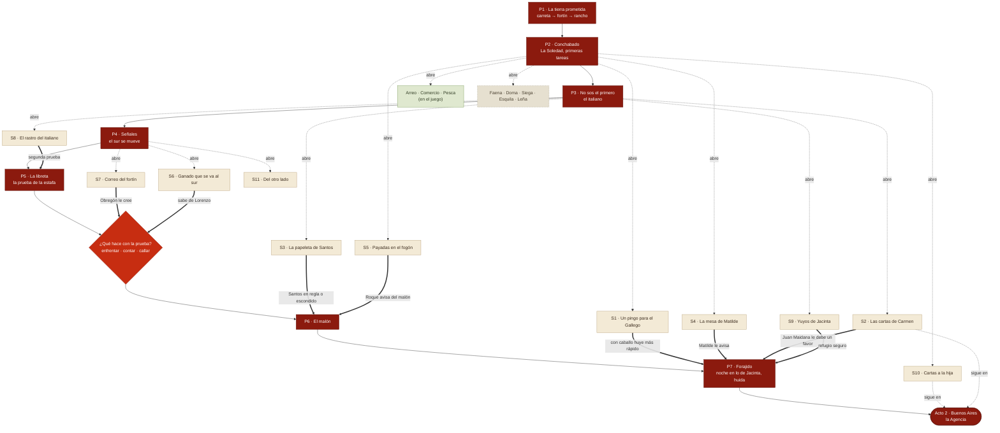

# Misiones del acto 1 (el pago)

Estado: **propuesta** para discutir. Sale de `arco-pago.md` (las cinco etapas, acordadas), `personajes.md`, `caballo.md`, `../mundo/economia.md` y `charla-ia.md`. Donde dice **en el juego**, ya funciona; lo demás está por hacer.

Cómo se lee:
- **Rama principal** (P1 a P7): la historia del Gallego. No se puede saltear; cada una abre la siguiente.
- **Secundarias** (S): se abren en una etapa y se pueden hacer o no. Muchas **dejan marcas** que cambian algo de la rama principal (sobre todo el malón y la huida). Eso es lo que hace que valgan la pena.
- **Oficios** (O): trabajo repetible para ganar plata y subir habilidades. No cuentan historia, pero sostienen el día a día.

## El cuadro

Las flechas gruesas son **marcas**: lo que la secundaria cambia en la rama principal.

---

## Rama principal

### P1 · La tierra prometida (etapa 1: llegada)

Estado: **acordado** y **en el juego** (la noche de la llegada). El guion completo de la escena está más abajo, en "P1 en detalle".

- **Quién**: Juan Maidana, el Teniente Obregón, Santos. A la mañana, Don Rufino.
- **Qué pasa**:
  1. Llega al atardecer en la carreta de Juan Maidana, que lo deja en la puerta del fortín y se vuelve enseguida: ya no hay forma de irse.
  2. Se presenta ante Obregón, que le revela que su tierra está diez leguas al sur, del otro lado de la frontera (**revelación 1**).
  3. Obregón lo manda a La Soledad, y Santos lo lleva de noche, con el farol, hacia el rancho de peones.
  4. Fundido a negro: *La mañana siguiente*.
  5. Despierta en el catre. Golpean la puerta y, cuando sale, lo espera **Rufino**, amable: se queda con el título y el pasaporte "para hacer el reclamo". Después arranca el juego libre.
- **Enseña**: caminar, hablar, seguir a alguien, que de noche el campo es oscuro y se anda con farol.
- **Termina**: en el rancho de peones, conchabado y sin papeles.

### P2 · Conchabado (etapa 2)
- **Quién**: Don Vicente, Anselmo, Santos, Roque, Ramón.
- **Qué hace el jugador**: se presenta en La Soledad y Anselmo le da tareas. Para avanzar, **dos de cuatro**:
  - **arreo** con Anselmo (*en el juego*);
  - **faena** con Santos;
  - **doma** con Roque;
  - **comercio** con Ramón (*en el juego*).
- **Rufino**: le pide la papeleta de conchabo cada vez que lo cruza.
- **Enseña**: los oficios, la plata, el morral, el hambre y el cansancio.
- **Termina**: cuando Anselmo le dice "ya no sos tan inútil, Gallego" (sube la confianza).

### P3 · No sos el primero (etapa 2, revelación 2)
- **Quién**: Juana, Hilario.
- **Qué hace el jugador**:
  1. Juana le suelta: "El año pasado vino un italiano con un papel igualito".
  2. Hilario cuenta que el italiano se fue al sur a buscar su tierra y no volvió.
  3. **Propuesta**: el **rancho abandonado** era del italiano. Ahí encuentra sus cosas, y entre ellas un título igual al suyo, de la misma Agencia.
- **Termina**: con el Gallego sabiendo que no fue un error suyo.

### P4 · Señales (etapa 3)
- **Quién**: Hilario, Juana, Obregón, Petrona.
- **Qué hace el jugador**:
  - Hilario le muestra señales del sur: pájaros que vuelan raro, rastros de caballada, humo.
  - Juana y Petrona traen rumores de la leva y de la guerra.
  - Obregón se queja de que no tiene hombres.
- **Enseña**: mirar el campo (posible habilidad *Rastreo*).
- **Termina**: cuando el Gallego se entera de que sin pasaporte lo pueden mandar a la leva.

### P5 · La libreta (etapa 3, revelación 3)
- **Quién**: Ramón, Rufino.
- **Qué hace el jugador**:
  1. Como sabe leer, llega a la **libreta de fiados** de Ramón. Puede pedir fiado y mirar mientras Ramón anota, o entrar de noche.
  2. Encuentra los pagos de la Agencia a Rufino y una lista de inmigrantes, con su nombre.
  3. Arranca la página.
- **Decisión**:

| Elige | Qué pasa después |
|---|---|
| **Enfrentar a Rufino** | Rufino sabe que él sabe. En P7 lo acusa más rápido, pero el jugador gana tiempo de ventaja. |
| **Contárselo a Obregón** | Si hizo *S7*, Obregón le cree y en P7 lo deja escapar por el vado. Si no, lo escucha y no hace nada. |
| **Callar y guardar la prueba** | Nadie sabe nada. En P7 llega a Buenos Aires con la página como única carta. |

- **Termina**: con la página en el morral.

### P6 · El malón (etapa 4)
- **Quién**: todos.
- **Qué hace el jugador**:
  - De noche, el malón llega desde el sur y el pago se quema.
  - Anselmo muere defendiendo los corrales.
  - El Gallego puede salvar a **una** persona: Santos o Carmen (pregunta abierta).
- **Marcas que pesan**: *S3* (Santos), *S5* (Roque avisa antes), *S1* (con caballo llega a más lugares).
- **Termina**: al amanecer, entre lo quemado.
- **Cuidado**: el malón tiene causas (tratos rotos, raciones que no llegan, la frontera que avanza). Que no se vea como un ataque de villanos sin rostro: Lorenzo y Roque son la ventana a ese otro punto de vista.

### P7 · Forajido (etapa 5: la huida)
- **Quién**: Rufino, Matilde, Jacinta, Juan Maidana.
- **Qué hace el jugador**:
  1. Rufino lo acusa de haber pactado con los indios, y lo declaran forajido.
  2. Se esconde la primera noche en el rancho de Jacinta.
  3. Se escapa en la carreta de Juan Maidana con la página de la libreta.
- **Marcas que pesan**:
  - *S4*: Matilde le avisa antes de que llegue la partida.
  - *S9*: Jacinta lo recibe sin preguntas.
  - *S2*: Juan Maidana lo esconde entre la carga.
  - *S1*: puede escapar a caballo.
  - La decisión de P5.
- **Termina**: en el camino a Buenos Aires. **Gancho al acto 2**: buscar la Agencia de Emigración Trasatlántica.

---

## Secundarias

| # | Misión | Quién | Se abre | Molde | Qué hay que hacer | Recompensa | Marca en la principal | Estado |
|---|---|---|---|---|---|---|---|---|
| S1 | **Un pingo para el Gallego** | Petrona, Santos | P2 | Comprar / ayudar | Conseguir el primer caballo: comprarle un mancarrón a Petrona con la plata del arreo y la pesca, o ganárselo trabajando para ella. Santos quiere el mismo caballo | El caballo (hoy, la O en pruebas) | Huida a caballo en P7 | El manejo ya está en el juego; falta decidir cómo se consigue (`caballo.md`) |
| S2 | **Las cartas de Carmen** | Carmen, Juan Maidana | P3 | Llevar | Llevar a escondidas las cartas de Carmen hasta la carreta de Juan Maidana, sin que la vea Vicente | Confianza de Carmen y de Juan Maidana | Juan Maidana lo esconde en P7; el corresponsal de Carmen reaparece en Buenos Aires | Propuesta |
| S3 | **La papeleta de Santos** | Santos, Rufino | P3 | Averiguar / ayudar | Santos no tiene la papeleta en regla y le tiene miedo a la leva. Conseguirle una (¿falsa?) o esconderlo | Santos como amigo de verdad | En P6 Santos está en el pago o escondido, y eso decide si se lo puede salvar | Propuesta |
| S4 | **La mesa de Matilde** | Matilde | P2 | Ayudar | Tareas de la casa: traer agua del pozo, leña, pescado para la cocina. Matilde le da de comer | Comida (contra el hambre), confianza | Matilde le avisa en P7 | Propuesta (la comida y el pescado ya existen) |
| S5 | **Payadas en el fogón** | Roque | P2 | Averiguar | A la noche, en el fogón de los ranchos, Roque payá. Escucharlo varias noches; cada payada trae una pista de la frontera | Pistas y habilidad *Doma* | Roque avisa del malón un rato antes en P6 | Los fogones y sus horarios ya están en el juego |
| S6 | **Ganado que se va al sur** | Vicente, Lorenzo | P4 | Averiguar | Ver de noche a Lorenzo llevándose ganado de La Soledad. Seguirlo hasta el vado | Saber el secreto de Vicente | En la decisión de P5 tiene algo más con qué presionar. Pero si lo vieron con Lorenzo, Rufino lo usa en P7 | Propuesta |
| S7 | **Correo del fortín** | Obregón | P4 | Llevar / acompañar | Llevar un parte del fortín a la posta para que salga con la galera. Vigilar una noche desde el mangrullo | Confianza de Obregón | Obregón le cree en P5 | Propuesta (el mangrullo ya está en el juego) |
| S8 | **El rastro del italiano** | Hilario | P3 | Buscar | Seguir con Hilario el rastro del italiano hasta el cañadón. Encontrar una prenda o un papel suyo | *Rastreo*, segunda prueba | Una prueba más para la decisión de P5 | Propuesta |
| S9 | **Yuyos de Jacinta** | Jacinta | P3 | Ayudar / aprender | Juntar yuyos en la orilla y aprender remedios. Ya enseña a salar pescado | Recetas (pescado salado *en el juego*; remedios, propuesta) | Jacinta lo recibe sin preguntas en P7 | En parte en el juego |
| S10 | **Cartas a la hija** | Juan Maidana, Carmen | P2 | Llevar (repetible) | El Gallego le escribe a su hija. Carmen le presta papel y tinta, y Juan Maidana lleva la carta hasta el correo | Ninguna material: es el hilo emocional | Sigue en Buenos Aires (¿llegan respuestas?) | Propuesta |
| S11 | **Del otro lado** | Lorenzo, Roque | P4 | Acompañar | Con Lorenzo como baqueano, cruzar el vado y llegar a la toldería a cambiar yerba y tabaco por cueros y plumas. Ver con sus ojos las tierras del título | Comercio, otra mirada de la frontera | Pesa en la acusación de P7 ("lo vieron con los indios") y en lo que el jugador entiende del malón | Propuesta. Necesita abrir el vado y que se pueda hablar en la toldería |

## Oficios (repetibles)

| Oficio | Con quién | Estado |
|---|---|---|
| Arreo de vacas | Anselmo | **En el juego** |
| Comercio en la pulpería | Ramón | **En el juego** |
| Pesca y lombrices | La laguna y el arroyo | **En el juego** |
| Faena | Santos | Propuesta (`personajes.md`) |
| Doma | Roque | Propuesta (`personajes.md`) |
| **Siega del trigo** | Anselmo, en los sembrados de La Soledad | Propuesta (`economia.md`). El Gallego es labrador: lo único que hace mejor que los paisanos |
| Esquila | Estancia | Propuesta: 1867 es plena fiebre del lanar |
| Leña y bosta seca | El monte del este, la pampa | Propuesta (`economia.md`) |

## Secundarias para más adelante

Con los personajes nuevos que propone `charla-ia.md`, todavía sin ficha: Doña Eduarda Ugarte (la vecina rival, cueros y chismes de los Larralde), Domingo Figueroa (tropa de carretas), Genaro Arrieta (caballos perdidos), Bernarda Gómez (la lavandera), Josefa Ríos (la partera, un parto de noche), Ceferino Maidana (el cuatrero de poca monta), Benito Acosta (el hijo de Hilario) y Escolástica Pérez (la promesa al santo). Pueden ser también las que ofrezca la charla con IA, por molde.

## Preguntas abiertas

1. ¿Cuántas tareas de P2 hacen falta para avanzar: dos de cuatro, o una de cada personaje?
2. ¿El rancho abandonado es del italiano?
3. ¿Cómo llega a la libreta en P5: fiado, de noche, o se la da alguien?
4. ¿A quién puede salvar en el malón (Santos o Carmen), y qué pasa con el otro?
5. ¿*S11 Del otro lado* va en el acto 1? Es la más delicada: muestra la toldería por dentro y le da cara a la gente del malón. Ayuda a que no sean villanos sin rostro, pero cambia el tono del malón.
6. ¿Cuál es el castigo por fallar una secundaria? Propuesta: ninguno directo. Solo se pierde la marca.
7. ¿Hay un tiempo límite entre P4 y P6, para que no se puedan hacer todas las secundarias?

---

## P1 en detalle: la noche de la llegada

Atardecer (las 18), invierno o primavera. El cielo gris de la pampa, el sol bajo.

**Cómo hablan** (según `voz.md`):
- **El Gallego** es castellano: usa *tú* con quien le tiene confianza, *usted* con la autoridad y algún tiempo castellano (*lo he pagado*, *he de ir*, *preguntase*).
- **Juan Maidana** y **Santos**, criollos, usan alguna marca suelta (*paraos*, *atao*, *pa'*), nunca más de dos por línea. Santos lo trata de *vos*; Juan Maidana, de *usted*, porque es su pasajero.
- **Obregón** y **Rufino** hablan cuidado, de *usted*. Rufino usa fórmulas de papeles (*paso a decirle*, *elevarlo*).

### 1. La carreta (18:00 a 18:40)
El Gallego viene sentado en la cola de la carreta de bueyes de Juan Maidana, con las piernas colgando. Juan Maidana va adelante, manejando con la picana. El jugador no maneja: mira. Juan Maidana va hablando:
- "¿Ve aquellos palos paraos, Gallego? El fortín. Más al sur ya no hay estancias."
- "Pregunte por el teniente Obregón. Es seco, pero derecho."
- "Yo lo dejo en la puerta y me vuelvo, que tengo que hacer noche en la posta."

### 2. La despedida
La carreta para frente al fortín. El Gallego baja con su atado.
- **Juan Maidana**: "Hasta acá llegamos, Gallego. Tome su atao."
- **Gallego**: "¿Y no me esperas? Mañana he de ir a ver mis tierras."
- **Juan Maidana**: "¿Esperarlo? Ni loco hago noche en la frontera. Suerte con esas tierras… y que Dios lo ayude."

La carreta da una vuelta abierta, del lado contrario al fortín, y se va por donde vino. Ya no hay vuelta atrás. Tarea: *Presentate ante el comandante del fortín*.

### 3. El fortín: la revelación
Adentro de la estacada, junto al mástil, el Teniente Obregón.
- **Obregón**: "Teniente Obregón, comandante de este fortín. ¿Y usted quién es, que llega a estas horas y de a pie?"
- **Gallego**: "Vengo de España, señor teniente. Compré tierra a la Agencia de Emigración Trasatlántica. Aquí traigo el título: me dijeron que preguntase en el fortín."
- *(Obregón despliega el papel y lo mira un rato largo, con la poca luz que queda.)*
- **Obregón**: "El campo que le han marcado queda diez leguas al sur. Del otro lado del cañadón. Del otro lado de la frontera."
- **Obregón**: "Allí no vive ningún cristiano, señor. Eso es Tierra Adentro: tierra de indios."
- **Gallego**: "Pero si lo he pagado. Lo he pagado todo: el pasaje, la tierra, los papeles…"
- **Obregón**: "No es usted el primero que me trae un papel así. Y yo nada puedo hacer: tengo veinte hombres mal comidos para cuidar diez leguas de frontera."
- **Obregón**: "Mañana pasa el juez de paz, Don Rufino Aramburu. Los reclamos son cosa suya."
- **Obregón**: "Esta noche no puedo tenerlo en el fortín. En La Soledad, la estancia de Larralde, siempre precisan un peón, y justo anda por acá el muchacho que trajo la carne. Él lo lleva."

*Cristiano* y *Tierra Adentro* son palabras de época (ver el vocabulario de `voz.md`); Obregón las aclara al pasar.

### 4. Santos
Junto al portón espera Santos, con un farol de aceite.
- **Santos**: "Santos Sosa, pa' servirle. Así que vos sos el gallego que trajo Maidana."
- **Gallego**: "No soy gallego, hombre. Soy de Castilla."
- **Santos**: "Acá todo el que viene de España es gallego, amigo. Ya te vas a acostumbrar."
- **Santos**: "Vamos, que se viene la noche. El rancho de los peones queda pa' allá, cruzando el campo. Pegate al farol, que de noche el campo engaña."

Tarea: *Seguí a Santos hasta el rancho de peones*.

### 5. La caminata (19:30 a 20:45)
Un tramo corto a campo traviesa, de noche, detrás del farol de Santos: unos 100 m, al paso del Gallego (unos veinte segundos). Si el Gallego se queda atrás, Santos lo espera ("¡Eh, Gallego! Pegate al farol."). En el camino, Santos habla:
- "¿Oís los teros? Gritan si pasa alguien. Son los mejores perros que tiene el pago."
- "Aquella luz es La Soledad, la estancia. El patrón es Don Vicente, pero en los corrales manda Anselmo, el capataz."
- "De noche no se anda sin farol. Si te perdés, buscá un fogón, que siempre hay algún cristiano."

### 6. La mañana siguiente
Fundido a negro, con el rótulo *La mañana siguiente*. Amanece (6:15).
1. El Gallego está dormido en el catre del rancho de peones.
2. Golpean la puerta. Desde afuera: "¡Ave María Purísima! ¿Hay alguien en el rancho?" Es el saludo de época al llegar a una casa.
3. El Gallego se levanta. Desde acá el jugador lo maneja. Tarea: *Alguien llama a la puerta del rancho. Salí a ver quién es.*
4. Cuando sale, lo espera Don Rufino:
- *(Afuera espera un señor de levita y galera, sonriente, con las botas bien lustradas.)*
- **Gallego**: "Sin pecado concebida. Buenos días, señor." (es la respuesta de época al *Ave María*)
- **Rufino**: "¡Buenos días, buenos días! Rufino Aramburu, juez de paz del partido, para servir a usted. ¿Es usted el español que llegó anoche al fortín?"
- **Gallego**: "El mismo. El teniente me dijo que los reclamos eran cosa de usted."
- **Rufino**: "Y le dijo bien. Ya estoy al tanto de lo de su tierra. Una lástima, una verdadera lástima. Esas agencias de Buenos Aires… no es usted el primero, créame."
- **Rufino**: "Pero no se me desanime. Paso a decirle cómo es el trámite: usted me confía el título, y el pasaporte también, que sin papeles no hay reclamo que valga. Yo me ocupo de elevarlo a Buenos Aires."
- **Gallego**: "¿El pasaporte también? Sin él no soy nadie en esta tierra."
- **Rufino**: "Es el trámite, amigo. En mis manos está más seguro que en un rancho de peones. Y mientras se resuelve, trabaje: en La Soledad siempre precisan brazos. Eso sí, consiga su papeleta de conchabo, que sin ella la partida no pregunta dos veces."
- *(Don Rufino guarda los papeles en la levita, se toca el ala de la galera y se va por el camino.)*

Rufino se aleja por el camino y después vuelve a su lugar de siempre, en la pulpería. Empieza el juego libre. Tarea: *Etapa 1 · El pago. Don Rufino se quedó con tu título y tu pasaporte, «para hacer el reclamo». Mientras tanto, a trabajar: Anselmo reparte las tareas en los corrales de La Soledad.*

*Pendiente*: que el título y el pasaporte existan como objetos del morral (que el Gallego los tenga al llegar y los pierda acá). Es código: pedir a desarrollo.

*A verificar*: el *Ave María Purísima / Sin pecado concebida* está bien documentado en el campo rioplatense del siglo XIX, pero conviene confirmarlo con una fuente antes de darlo por bueno.

### Faroles de aceite
De noche, la gente que anda fuera de los poblados lleva un farol de aceite en la mano, con su luz. Lo llevan Santos en la llegada y, en cada ronda de fogón, uno de los que vuelven a su casa de noche. Para dárselo a un personaje: accesorio **Farol** en su ficha. De día el farol no se lleva. *Propuesta*: que el Gallego pueda comprar uno en la pulpería y llevarlo él.

### Para probar
- La llegada se juega sola al darle Play (objeto **Juego** → componente `LlegadaP1`, casilla *Jugar*).
- **Backspace** la saltea y deja al Gallego en la mañana siguiente (sin la escena de Rufino).
- En el componente se ajustan la velocidad de la carreta, la de Santos (0 es al paso del Gallego), los metros de caminata antes del fundido (100) y la ficha de Rufino (por si algún día no está en la escena).
- Solo se juega si se da Play con el pago abierto: al volver de Buenos Aires o en los tests, el juego arranca como siempre.
- Juan Maidana maneja la carreta sentado adelante, con la picana, como en las fotos de época. Lo mismo vale para su carreta del camino real.

